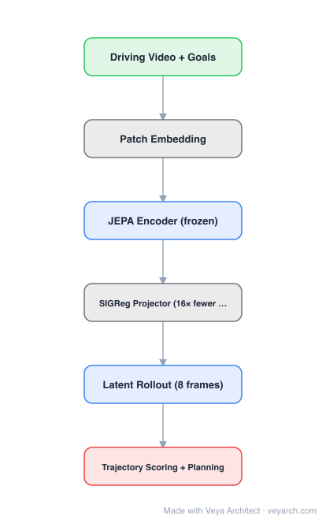

# Architecture: AD-E2E-JEPA

## Motivation

Autonomous driving requires planning: given the current scene and a goal, which trajectory is best? Existing approaches either train a driving policy via imitation/reinforcement learning (expensive, task-specific) or use generative video world models (pixel-space, slow). V-JEPA 2-AC showed that latent-space world models can drive real robots. AD-E2E-JEPA asks: can the same approach work for autonomous driving, and can SIGReg's efficiency benefits make it fast enough for real-time planning?

## Core Idea

Use a JEPA world model for driving: encode the current driving scene into latent space, condition on candidate trajectories, roll out future latents, and score them against a goal — all in latent space, no pixel generation. The key innovation is a **SIGReg-regularized learnable projector** that compresses the latent representation for planning: 16× fewer planning patches, 4× smaller embedding dimension. This enables 100× faster inference, making real-time trajectory scoring over 256 candidates feasible (0.8 seconds total). No driving policy is trained — the world model performs zero-shot goal-conditioned planning.

## Architecture

### Overview

<b>Layer-by-layer (6 nodes)</b>

| # | Layer | Type | Params |
|---|---|---|---|
| 1 | Driving Video + Goals | `input` |  |
| 2 | Patch Embedding | `custom` |  |
| 3 | JEPA Encoder (frozen) | `attention` |  |
| 4 | SIGReg Projector (16× fewer patches) | `custom` |  |
| 5 | Latent Rollout (8 frames) | `attention` |  |
| 6 | Trajectory Scoring + Planning | `output` |  |

### Components

1. **Driving video + goals** — multi-camera driving video input plus goal specification (target position, navigation waypoints).
2. **Patch embedding** — standard patch tokenization of driving camera frames.
3. **JEPA encoder (frozen)** — a pretrained JEPA video encoder (V-JEPA 2 style) that produces spatial latent features. Frozen during planning — only the projector and rollout are active at inference.
4. **SIGReg projector** — the key innovation: a learnable projection that compresses the encoder's spatial features for planning. Reduces patch count by 16× (e.g., from 256 to 16 patches) and embedding dimension by 4×. Regularized with SIGReg to prevent collapse in the compressed space. This is what enables 100× faster inference.
5. **Latent rollout (8 frames)** — given the compressed latent and a candidate trajectory, predict 8 future frames' latents. This is the world model's dynamics component, operating in the compressed space.
6. **Trajectory scoring + planning** — score each of 256 candidate trajectories by comparing the rolled-out latents to the goal latent. Select the best trajectory. No driving policy network — planning is pure latent-space model-predictive control.

### Data Flow

Driving video → patch embedding → frozen JEPA encoder → SIGReg projector (compress 16×) → latent rollout (8 frames, conditioned on candidate trajectory) → score against goal → select best trajectory. 256 candidate trajectories scored in 0.8 seconds total.

### State / Memory

No persistent state during a single planning step. The frozen encoder's weights are the "memory" from pretraining. During rollout, the compressed latent state is carried forward across the 8 prediction steps.

## Design Decisions

- **Frozen encoder** — the JEPA encoder is pretrained on general video and frozen for driving. Only the SIGReg projector is trained on driving data, which is lightweight.
- **SIGReg projector for compression** — the projector doesn't just compress; it's regularized with SIGReg to ensure the compressed space doesn't collapse. This is critical: naive compression would lose information; SIGReg ensures the compressed space retains the structure needed for planning.
- **16× patch reduction, 4× dim reduction** — these ratios were found to be optimal: aggressive enough for 100× speedup, conservative enough to retain planning performance.
- **No trained driving policy** — the world model itself plans by scoring trajectory candidates. This is zero-shot: no imitation learning, no reinforcement learning, no reward function needed for planning.
- **Self-supervised pretraining projector** — the projector can be pretrained via self-supervised JEPA objectives on driving video, then transferred to the planning pipeline. This improves downstream imitation learning from 80.2 to 85.4 EPDMS.

## Evolution

- **V-JEPA 2-AC** (2025): latent world model for robot manipulation — AD-E2E-JEPA extends to autonomous driving.
- **LeWM** (2026): end-to-end JEPA from pixels — AD-E2E-JEPA uses a frozen pretrained encoder instead, but adds the SIGReg projector for efficiency.
- **AD-E2E-JEPA** (2026): JEPA for driving with SIGReg projector — 100× faster than generative approaches.
- **Contrast**: generative driving world models (pixel-space) are slower; policy-based methods require training data for each task.

## Characteristics

| Property | Value |
|---|---|
| Task | end-to-end autonomous driving via latent planning |
| Encoder | frozen JEPA (V-JEPA 2 style) |
| Projector | SIGReg-regularized, 16× patch reduction, 4× dim reduction |
| Rollout | 8 frames, latent space |
| Planning | 256 candidate trajectories, 0.8s total |
| Speed | 100× faster than generative video world models |
| Policy | none (zero-shot goal-conditioned planning) |
| NAVSIMv2 | 67.3/72.9 EPDMS, 84.1/86.5 EPDMS† |

## Limitations

- The frozen encoder is pretrained on general video, not driving-specific video — domain gap may limit performance in unusual driving scenarios.
- 256 candidate trajectories is a discrete set — continuous trajectory optimization is not supported.
- 8-frame rollout horizon may be too short for long-term planning (highway merging, complex intersections).
- The SIGReg projector's compression ratio (16×/4×) was tuned on NAVSIMv2; other domains may need different ratios.
- Zero-shot planning without a trained policy may underperform supervised methods on specific metrics.

## Implementation Notes

Essentials: (1) use a pretrained JEPA video encoder (V-JEPA 2 style), frozen, (2) train a SIGReg-regularized projector to compress the encoder's spatial features (target: 16× fewer patches, 4× smaller embedding), (3) train a latent rollout module to predict 8 future frames' compressed latents given a candidate trajectory, (4) at inference: encode current scene → compress via projector → for each of 256 candidate trajectories, roll out 8 frames → score against goal latent → select best, (5) the SIGReg projector can also be pretrained via self-supervised JEPA objectives on driving video for better initialization. The key efficiency insight: planning in compressed latent space is 100× faster than planning in full latent space or pixel space.
