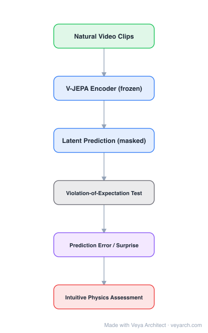

# Architecture: Garrido Intuitive Physics

## Motivation

Do JEPA representations truly understand the physical world, or do they merely memorize visual patterns? This is a critical question for world models: if the latent space only encodes statistical correlations without physical understanding, then planning in that space will fail in novel physical situations. Developmental psychology offers a test: the **violation-of-expectation** paradigm. Infants look longer at "impossible" events (objects disappearing, passing through walls), indicating they have expectations about physical behavior. If a model shows higher prediction error for physically impossible events than for possible ones, it has "intuitive physics" understanding. This work applies this paradigm to JEPA representations.

## Core Idea

Take a pretrained V-JEPA model (latent-space predictor), a pixel-space prediction model, and a multimodal LLM (text-reasoning about physics). For each, measure the "surprise" (prediction error) on pairs of videos: one physically possible, one physically impossible (violating object permanence, shape consistency, or spatial continuity). If the model shows higher surprise for the impossible event, it "understands" that physical property. The key comparison: does latent-space prediction (V-JEPA) understand physics better than pixel-space prediction or text-based reasoning?

## Architecture

### Overview

<b>Layer-by-layer (6 nodes)</b>

| # | Layer | Type | Params |
|---|---|---|---|
| 1 | Natural Video Clips | `input` |  |
| 2 | V-JEPA Encoder (frozen) | `attention` |  |
| 3 | Latent Prediction (masked) | `attention` |  |
| 4 | Violation-of-Expectation Test | `custom` |  |
| 5 | Prediction Error / Surprise | `loss` |  |
| 6 | Intuitive Physics Assessment | `output` |  |

### Components

1. **Natural video clips** — pairs of videos: one physically possible, one physically impossible. The impossible videos violate one of three properties: object permanence (object disappears when occluded), shape consistency (object deforms), spatial continuity (object passes through a wall).
2. **V-JEPA encoder (frozen)** — a pretrained V-JEPA encoder processes the video clips. The encoder is frozen — no training, just inference. This tests whether the pretrained representation already contains physical understanding.
3. **Latent prediction (masked)** — the V-JEPA predictor predicts the latent representation of masked regions. The prediction error measures how "surprising" the masked content is to the model.
4. **Violation-of-expectation test** — for each video pair (possible vs impossible), compare the model's prediction error. If the impossible event has higher error, the model "expected" the possible event — it has intuitive physics understanding.
5. **Prediction error / surprise** — the metric: difference in prediction error between impossible and possible events. Positive difference = understanding. Near zero = no understanding (chance).
6. **Intuitive physics assessment** — the output: a per-property assessment (object permanence, shape consistency, spatial continuity) of whether the model exhibits intuitive physics understanding.

### Data Flow

Natural video clips (possible + impossible pairs) → V-JEPA encoder (frozen) → latent prediction of masked regions → compute prediction error for both possible and impossible clips → compare: is error higher for impossible? → if yes, model understands that physical property. Repeat for each property.

### State / Memory

No recurrent state. The V-JEPA encoder and predictor are frozen pretrained models. The assessment is a one-shot inference: encode, predict, compare errors. No training is performed during the assessment.

## Design Decisions

- **Violation-of-expectation as the evaluation paradigm** — borrowed from developmental psychology. The advantage: it doesn't require labeled physics data, only possible/impossible video pairs. The disadvantage: it's a binary signal (understands or doesn't), not a continuous physics simulation.
- **Frozen model evaluation** — no fine-tuning, no physics-specific training. This tests whether physical understanding **emerges** from self-supervised video pretraining, not whether it can be trained.
- **Three properties tested** — object permanence, shape consistency, spatial continuity. These are "core knowledge" properties that infants develop early. Testing them on models probes whether the same core knowledge emerges from prediction.
- **Comparison across representation types** — latent (V-JEPA) vs pixel (video prediction) vs text (MLLM). This isolates the role of representation space: does predicting in latent space (abstract) produce better physical understanding than predicting in pixel space (concrete) or reasoning in text (symbolic)?
- **One-week-video ablation** — testing models trained on only one week of unique video controls for data scale. If understanding emerges even with limited data, it's a fundamental property of the prediction objective, not a product of massive data.

## Evolution

- **V-JEPA** (2024): the model being evaluated — latent-space video prediction.
- **Garrido et al.** (2025): evaluates V-JEPA's physical understanding via violation-of-expectation.
- **LeWM** (2026): validates physical structure in latent space via physical quantity probing — complementary evidence.
- **Theoretical roots**: violation-of-expectation paradigm (Baillargeon, Spelke), core knowledge hypothesis (Spelke), predictive coding (Rao & Ballard).

## Characteristics

| Property | Value |
|---|---|
| Task | evaluate intuitive physics understanding in JEPA representations |
| Paradigm | violation-of-expectation (prediction error for impossible > possible) |
| Properties | object permanence, shape consistency, spatial continuity |
| Model | V-JEPA (frozen, no fine-tuning) |
| Comparison | latent (V-JEPA) > pixel (video pred) > text (MLLM) |
| Data ablation | above-chance even with 1 week of unique video |
| Implication | core knowledge emerges from self-supervised prediction |

## Limitations

- **Binary assessment** — violation-of-expectation gives a binary signal (understands or doesn't), not a quantitative physics simulation. It can't tell you how accurate the model's physical predictions are, only whether it has expectations at all.
- **Three properties only** — object permanence, shape consistency, spatial continuity are tested. Other physical properties (friction, gravity, momentum conservation) are not evaluated.
- **Implicit, not explicit** — the physical understanding is implicit in the latent space. The model can't decode explicit physical states (object positions, contact relationships) from its latent — it just shows surprise for violations. This is the key gap that motivates explicit geometric state prediction.
- **Video pairs must be constructed** — the possible/impossible video pairs must be carefully designed. Synthetic videos may not capture all nuances of real-world physics.
- **Near-chance for pixel and LLM** — pixel-space predictors and MLLMs perform near chance, but this may be due to their specific architectures, not a fundamental limitation. Better pixel predictors or MLLMs might show understanding.
- **No causal reasoning** — violation-of-expectation tests expectations, not causal reasoning. The model may have statistical expectations without causal understanding.

## Implementation Notes

Essentials: (1) take a pretrained V-JEPA model (encoder + predictor), frozen, (2) construct video pairs: for each physical property, create a possible video and an impossible video (violating that property), (3) for each video: encode with V-JEPA encoder, mask a region, predict the masked latent with V-JEPA predictor, compute prediction error, (4) compare: is prediction error higher for the impossible video than the possible video? If yes, the model "understands" that property, (5) repeat for object permanence (occlude an object, then either reveal it or make it disappear), shape consistency (show an object, then either keep its shape or deform it), spatial continuity (show an object moving toward a wall, then either stop at the wall or pass through), (6) for comparison: run the same test with pixel-space predictors (predict pixels, measure pixel error) and MLLMs (describe the video, measure text-based surprise). The key finding: latent-space prediction shows above-chance understanding; pixel and text don't. The key implication: predictive coding in abstract representation space is sufficient for intuitive physics — but the understanding is implicit, motivating explicit physical state prediction.
