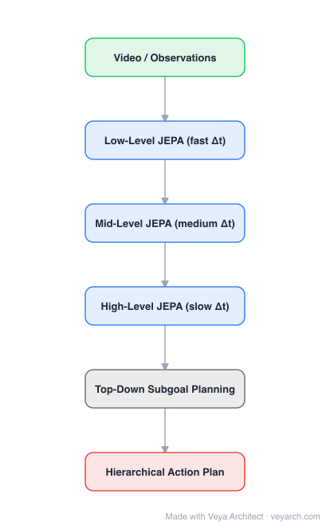

# Architecture: H-JEPA

## Motivation

Single-timescale JEPA world models (V-JEPA 2-AC, LeWM) have two limitations for long-range planning: (1) **error accumulation** — each rollout step introduces prediction error, and over many steps, the error compounds until the rollout diverges from reality; (2) **single-latent bottleneck** — one latent space must simultaneously encode fast-changing details (joint angles, contact forces) and slow-changing abstractions (which room am I in? am I holding an object?), which are fundamentally different time scales. H-JEPA addresses both by introducing a **hierarchy of JEPA layers**, each with its own latent space and temporal stride.

## Core Idea

Train a hierarchy of JEPA layers: Layer 0 (bottom) operates at the finest time step Δt and predicts one step ahead; Layer 1 operates at 2·Δt (or k·Δt) and predicts further ahead; Layer 2 operates at 4·Δt and predicts even further. Each layer has its **own latent space** — the higher layers' latents are more abstract (they discard fast, unpredictable details). Planning is **top-down**: Layer 2 predicts a distant-future state (the subgoal); Layer 1 plans toward that subgoal, producing intermediate subgoals for Layer 0; Layer 0 plans toward Layer 1's subgoals, producing actions. This decomposes long-range planning into a sequence of shorter, more tractable planning problems.

## Architecture

### Overview

<b>Layer-by-layer (6 nodes)</b>

| # | Layer | Type | Params |
|---|---|---|---|
| 1 | Video / Observations | `input` |  |
| 2 | Low-Level JEPA (fast Δt) | `attention` |  |
| 3 | Mid-Level JEPA (medium Δt) | `attention` |  |
| 4 | High-Level JEPA (slow Δt) | `attention` |  |
| 5 | Top-Down Subgoal Planning | `custom` |  |
| 6 | Hierarchical Action Plan | `output` |  |

### Components

1. **Video / observations** — raw visual input (or other observations) that all layers encode.
2. **Low-level JEPA (fast Δt)** — the bottom layer. Encodes observations at the finest temporal resolution. Predicts one step (Δt) ahead in its latent space. This layer captures fast dynamics: joint angles, contact forces, object velocities. Its latent space is detailed and high-dimensional.
3. **Mid-level JEPA (medium Δt)** — operates at a coarser time step (e.g., 2·Δt or 4·Δt). Predicts further ahead. Its latent space is more abstract: it discards fast unpredictable details (exact joint angles) and retains medium-scale state (approximate object positions, agent location). It takes the low-level latent as input and produces a coarser representation.
4. **High-level JEPA (slow Δt)** — the top layer. Operates at the coarsest time step (e.g., 8·Δt or 16·Δt). Predicts the furthest ahead. Its latent space is the most abstract: "which room am I in?", "am I holding the target object?", "what is the high-level subgoal?". It discards all fast and medium details.
5. **Top-down subgoal planning** — the planning procedure: the high-level layer predicts a distant-future state (the goal/subgoal). This prediction is projected down to the mid-level latent space as a subgoal. The mid-level plans toward this subgoal, producing subgoals for the low-level. The low-level plans toward its subgoals, producing actions.
6. **Hierarchical action plan** — the output is a sequence of actions, but they were planned hierarchically: high-level strategy → mid-level tactics → low-level actions. This decomposition means long-range plans are more stable (high-level predictions are coarse but robust) and short-range plans are precise (low-level predictions are detailed but short-horizon).

### Data Flow

**Training**: Video → all three JEPA layers encode simultaneously, each at its own temporal stride. Each layer trains via latent prediction (predict the next latent at its temporal scale). The layers are connected: the mid-level takes the low-level's latent as input (pooled/strided), and the high-level takes the mid-level's latent as input.

**Planning**: Goal → high-level JEPA predicts distant-future latent (subgoal) → project down to mid-level latent space → mid-level JEPA plans toward subgoal, producing intermediate subgoals → project down to low-level → low-level JEPA plans toward subgoals, producing actions → execute first action → replan.

### State / Memory

Each layer maintains its own latent state during rollout. The hierarchy means the high-level state changes slowly (updated every k steps), the mid-level changes at medium rate, and the low-level changes every step. This temporal hierarchy is the key to stable long-range planning: the high-level provides stable long-range guidance, while the low-level provides precise short-range control.

## Design Decisions

- **Separate latent spaces per layer** — prevents the single-latent bottleneck. Fast and slow dynamics don't compete for the same representational capacity. The high-level latent can be small and abstract; the low-level latent can be large and detailed.
- **Temporal stride hierarchy** — each layer predicts at a coarser time step. This means the high-level layer's rollout has fewer steps for the same planning horizon, reducing error accumulation. A 64-step plan at the low level is only an 8-step plan at the mid level and a 4-step plan at the high level.
- **Top-down planning** — the high-level decides "where to go", the mid-level decides "how to get there roughly", the low-level decides "exact actions". This mirrors how humans plan: high-level intention → mid-level strategy → low-level motor control.
- **Upper layers discard fast details** — by design, the higher layers' latents are trained to predict only slow, task-relevant state. Fast unpredictable details (leaf fluttering, texture noise) are filtered out, making high-level predictions more robust.
- **End-to-end learning** — the entire hierarchy is trained end-to-end, not manually designed. The temporal strides and latent dimensions are hyperparameters, but the representations are learned.

## Evolution

- **V-JEPA 2-AC** (2025): single-timescale JEPA world model for robot manipulation — limited by error accumulation and single-latent bottleneck.
- **LeWM** (2026): end-to-end single-timescale JEPA — same limitations.
- **LeHami** (2026): addresses error accumulation at a single level via symplectic dynamics — complementary to H-JEPA's hierarchical approach.
- **H-JEPA** (2026): addresses both error accumulation and single-latent bottleneck via temporal hierarchy.
- **Theoretical roots**: hierarchical reinforcement learning (MAXQ, FeUdal Networks), temporal abstraction (options framework), hierarchical planning in classical AI.

## Characteristics

| Property | Value |
|---|---|
| Task | hierarchical world model for visual planning |
| Hierarchy | 3 layers (low/mid/high), each with own latent + temporal stride |
| Planning | top-down subgoal decomposition |
| Temporal strides | low: Δt, mid: k·Δt, high: k²·Δt |
| Error accumulation | reduced (high-level has fewer rollout steps) |
| Visual AntMaze | 18% → 73% success (3-layer hierarchy) |
| Compute | less planning compute than flat baseline |
| Validation | Visual AntMaze + DROID real robot video |

## Limitations

- **Hierarchy depth is a hyperparameter** — how many levels to use, and what temporal strides, must be tuned per task.
- **Information loss between levels** — projecting from low-level to mid-level latent space loses information. If the projection is too aggressive, the mid-level can't guide the low-level precisely.
- **Training complexity** — training multiple JEPA layers end-to-end is more complex than training a single layer. Gradient flow through the hierarchy may be unstable.
- **Subgoal projection** — projecting a high-level subgoal down to a low-level subgoal requires a learned mapping, which may not always produce feasible subgoals.
- **Validated on AntMaze and DROID** — more diverse environments needed to confirm generality.

## Implementation Notes

Essentials: (1) train N JEPA layers, each with its own encoder and predictor, (2) connect layers: layer i+1's input is a strided/pooled version of layer i's latent, (3) each layer predicts at its own temporal scale: layer 0 predicts 1 step, layer 1 predicts k steps, layer 2 predicts k² steps, (4) for planning: start at the top layer, predict the goal latent, (5) project the goal latent down to the layer below as a subgoal, (6) the layer below plans toward the subgoal (optimize actions to reach it), producing subgoals for the layer below that, (7) repeat down to the bottom layer, which outputs actions, (8) execute the first action and replan. The key insight: temporal hierarchy decomposes a long, error-prone rollout into a sequence of short, manageable rollouts at different abstraction levels.
