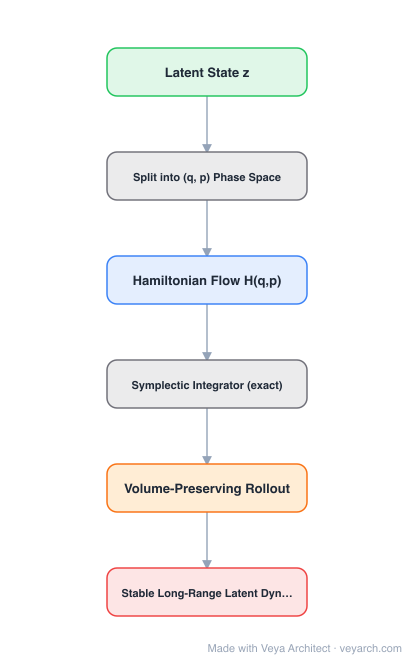

# Architecture: LeHami

## Motivation

JEPA world models (V-JEPA 2-AC, LeWM) use unconstrained predictors to roll out latent dynamics: `ẑ_{t+1} = predictor(ẑ_t, a_t)`. In theory, this should work. In practice, LeHami discovers a subtle failure mode: **predictor contraction**. Each prediction step introduces a tiny contraction of the latent distribution (because the predictor's learned dynamics are slightly dissipative). Over a long rollout, these contractions compound multiplicatively, causing the latent distribution to gradually shrink toward a point — a form of representation collapse that manifests during planning, not during training. The loss looks fine during training (single-step), but multi-step rollout degrades. LeHami asks: can we constrain the predictor to be **volume-preserving**, eliminating contraction by construction?

## Core Idea

Replace the unconstrained predictor with a **Hamiltonian flow** on a structured latent state (q, p), where q represents generalized positions and p represents generalized momenta. The Hamiltonian H(q, p) is a learned scalar function. The dynamics are:
- `dq/dt = ∂H/∂p`
- `dp/dt = -∂H/∂q`

These are integrated using an **exact symplectic integrator** (e.g., leapfrog/Stormer-Verlet). The key property: a symplectic integrator is a **symplectic diffeomorphism** — it exactly preserves the phase space volume at every step, for any step size and any Hamiltonian parameters. This is not approximate volume preservation; it is exact, by the mathematical structure of symplectic maps.

**Proposition 1**: The symplectic integration step is an exact symplectic diffeomorphism at any step size and any parameters, therefore exactly preserving phase space volume. This excludes three collapse modes: (1) uniform contraction, (2) convergence to asymptotically stable fixed points, (3) merging of distinct states.

## Architecture

### Overview

<b>Layer-by-layer (6 nodes)</b>

| # | Layer | Type | Params |
|---|---|---|---|
| 1 | Latent State z | `input` |  |
| 2 | Split into (q, p) Phase Space | `custom` |  |
| 3 | Hamiltonian Flow H(q,p) | `attention` |  |
| 4 | Symplectic Integrator (exact) | `custom` |  |
| 5 | Volume-Preserving Rollout | `custom` |  |
| 6 | Stable Long-Range Latent Dynamics | `output` |  |

### Components

1. **Latent state z** — the JEPA encoder's output latent representation, which will be reinterpreted as a phase space state.
2. **Split into (q, p) phase space** — the latent z is split into two equal halves: q (generalized positions) and p (generalized momenta). This gives the latent a Hamiltonian structure. The split is a design choice — the encoder produces a flat latent, and we impose the (q, p) structure post-hoc.
3. **Hamiltonian flow H(q, p)** — a learned neural network that computes the scalar Hamiltonian H(q, p). The dynamics are derived from H via Hamilton's equations: `dq/dt = ∂H/∂p`, `dp/dt = -∂H/∂q`. The gradients are computed via automatic differentiation.
4. **Symplectic integrator (exact)** — integrates Hamilton's equations using a symplectic method (e.g., leapfrog). The key property: this integrator is **exactly symplectic** — it preserves phase space volume exactly, not approximately. This is a property of the integrator's mathematical structure, not a learned behavior.
5. **Volume-preserving rollout** — multi-step rollout using the symplectic integrator. Each step exactly preserves volume, so the rollout cannot contract, cannot converge to a fixed point, and cannot merge states. The latent distribution's shape may change (shear, rotation), but its volume is invariant.
6. **Stable long-range latent dynamics** — the output is a rollout that remains stable over long horizons, suitable for planning. The volume preservation guarantees that the rollout does not collapse.

### Data Flow

Latent z → split into (q, p) → compute H(q, p) → derive dynamics via Hamilton's equations (∂H/∂p, -∂H/∂q) → symplectic integration step → next (q, p) → repeat for T steps → stable rollout. Time reversal: flip sign of p → integrate backward → backward rollout for safety verification.

### State / Memory

The (q, p) phase space state is carried forward during rollout. The Hamiltonian H is a fixed learned function (no recurrence). The symplectic integrator is deterministic given H and the step size. The state at step t fully determines the state at step t+1 (Markovian), and because the integrator is symplectic, the mapping is invertible (time-reversible).

## Design Decisions

- **Hamiltonian structure as inductive bias** — physics tells us that conservative (non-dissipative) dynamics are Hamiltonian. By imposing this structure, we get volume preservation for free. The cost: the dynamics must be expressible as a Hamiltonian, which excludes dissipative systems (friction, contact damping). Port-Hamiltonian extensions can handle dissipation but are not covered in this paper.
- **Exact symplectic integration** — approximate volume preservation (e.g., using a generic ODE solver) would still drift over long rollouts. Exact symplectic integration guarantees zero volume drift at every step, regardless of step size.
- **(q, p) split of latent** — the encoder produces a flat latent that is split into position and momentum halves. This is a structural choice that gives the latent a phase space interpretation. The split means the latent dimension must be even.
- **Continuous-time** — because the Hamiltonian is a continuous function and the symplectic integrator works at any step size, a single trained model can be integrated at different temporal resolutions without retraining.
- **Time reversibility** — symplectic maps are invertible. Flipping the sign of p reverses the dynamics, enabling backward rollout. This is useful for safety (can the system return to a safe state?) and counterfactual reasoning.

## Evolution

- **LeWM** (2026): end-to-end JEPA world model with unconstrained predictor — susceptible to predictor contraction.
- **V-JEPA 2-AC** (2025): action-conditioned unconstrained predictor — same susceptibility.
- **LeHami** (2026): replaces unconstrained predictor with Hamiltonian flow + symplectic integrator — eliminates contraction.
- **Sibling: LpWM** (2026): addresses rollout stability via sparse representations (different mechanism).
- **Theoretical roots**: Hamiltonian mechanics, symplectic geometry, geometric integration.

## Characteristics

| Property | Value |
|---|---|
| Task | latent world model with stable long-range rollout |
| Predictor | Hamiltonian flow H(q,p) + symplectic integrator |
| Latent structure | (q, p) phase space (split of encoder output) |
| Volume preservation | exact (symplectic diffeomorphism) |
| Collapse modes excluded | uniform contraction, fixed-point convergence, state merging |
| Continuous-time | single model, any step size |
| Time reversibility | yes (flip p sign) |
| Validation | pendulum environments |

## Limitations

- **Hamiltonian = conservative dynamics only** — no dissipation. Real robot environments have friction, contact damping, and energy loss. Port-Hamiltonian extensions (not covered) can handle dissipation but break exact volume preservation.
- **Pendulum validation only** — the paper validates on pendulum environments. Multi-body contact-rich scenarios (grasping, pushing) are untested.
- **(q, p) split is artificial** — the encoder's latent has no inherent position/momentum structure; the split is imposed. The Hamiltonian must learn to make this split meaningful.
- **Action conditioning not detailed** — how actions enter the Hamiltonian (as generalized forces? as modifications to H?) needs clarification for robot control.
- **Symplectic integrator step size** — while any step size preserves volume, large step sizes introduce integration error (the trajectory deviates from the true Hamiltonian flow, even though volume is preserved).

## Implementation Notes

Essentials: (1) train a JEPA encoder as usual (e.g., LeWM setup), (2) split the latent z into (q, p) halves, (3) parameterize H(q, p) as a neural network (scalar output), (4) compute dynamics via autograd: `dq/dt = ∂H/∂p`, `dp/dt = -∂H/∂q`, (5) integrate using leapfrog (Stormer-Verlet): half-step q, full-step p, half-step q — this is symplectic, (6) for rollout: repeat the symplectic step T times, (7) for time reversal: negate p and integrate forward (this gives the backward trajectory), (8) for dissipative systems: consider Port-Hamiltonian extension (add a dissipation term to dp/dt) — but this breaks exact volume preservation. The key insight: the symplectic structure is an inductive bias from physics that eliminates an entire class of failure modes (contraction-based collapse) by construction.
