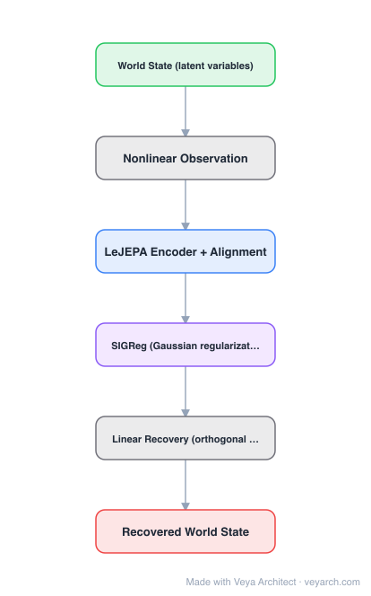

# Architecture: LeJEPA Identifiability

## Motivation

LeJEPA demonstrated that SIGReg (isotropic Gaussian regularization) produces strong representations empirically. But a fundamental question remained: do these representations correspond to the **true latent variables of the world**, or are they arbitrary statistical compressions? This is the identifiability question from causal representation learning: under what conditions can a learned representation recover the ground-truth latent variables, and up to what transformation? Without identifiability, planning in latent space is planning in an arbitrary coordinate system — there is no guarantee that the latent dimensions correspond to meaningful degrees of freedom.

## Core Idea

Prove that LeJEPA's alignment objective + SIGReg (Gaussian regularization) **linearly identifies** the world's latent variables. "Linearly identifies" means: the learned representation is related to the true latent variables by a linear (specifically, orthogonal) transformation. This is the strongest form of identifiability short of exact recovery — any linear transform preserves the geometry needed for planning. The proof has two parts: (1) **forward**: under stationary additive noise transitions and Gaussian regularization, each nonlinear degree is penalized by the alignment objective, making linear mapping optimal (via spectral decomposition); (2) **reverse**: Gaussian is the **unique** distribution for which this holds — all non-Gaussian alternatives fail the guarantee.

## Architecture

### Overview

<b>Layer-by-layer (6 nodes)</b>

| # | Layer | Type | Params |
|---|---|---|---|
| 1 | World State (latent variables) | `input` |  |
| 2 | Nonlinear Observation | `custom` |  |
| 3 | LeJEPA Encoder + Alignment | `attention` |  |
| 4 | SIGReg (Gaussian regularization) | `loss` |  |
| 5 | Linear Recovery (orthogonal map) | `custom` |  |
| 6 | Recovered World State | `output` |  |

### Components

1. **World state (latent variables)** — the ground-truth latent variables of the world, evolving under stationary additive noise transitions: `z_{t+1} = f(z_t) + noise`.
2. **Nonlinear observation** — the world is observed through a nonlinear mixing function: `x = g(z)`. The encoder never sees `z` directly; it sees `x` (pixels, etc.).
3. **LeJEPA encoder + alignment** — the standard LeJEPA pipeline: encode observations, predict target representations from context representations.
4. **SIGReg (Gaussian regularization)** — forces the embedding distribution to match an isotropic Gaussian. The theorem proves this is not just empirically useful but **necessary** for identifiability.
5. **Linear recovery (orthogonal map)** — the theoretical result: the learned representation `ẑ` is related to the true latent `z` by `ẑ = R·z` where `R` is orthogonal. This means the representation recovers the true latent variables up to a rotation.
6. **Recovered world state** — because `R` is orthogonal, distances, angles, and planning are preserved. Optimal planning in the `ẑ` space is equivalent to optimal planning in the `z` space.

### Data Flow

World state z → nonlinear observation x → LeJEPA encoder → representation ẑ → SIGReg forces Gaussian → theorem: ẑ = R·z (R orthogonal) → recovered world state (planning-equivalent to true z).

### State / Memory

This is a theoretical analysis of LeJEPA's properties, not a new architecture. The "state" is the world's latent variables evolving under the transition dynamics.

## Design Decisions

- **Stationary additive noise assumption** — the guarantee requires `z_{t+1} = f(z_t) + noise` where `f` is fixed (stationary) and noise is additive. This is the key condition; many real-world dynamics (contacts, collisions) are non-stationary.
- **Gaussian uniqueness proof** — the reverse direction proves that if the embedding distribution is non-Gaussian, there exist worlds where identifiability fails. This provides the strongest possible justification for SIGReg's Gaussian target.
- **Orthogonal (not general linear) recovery** — the alignment objective's spectral structure forces the recovery transform to be orthogonal, not just any linear map. This preserves the metric structure needed for planning.
- **Approximate identifiability** — when conditions are partially violated, the guarantee degrades gracefully: the recovery error is bounded by the degree of condition violation.

## Evolution

- **Causal representation learning / ICA** (predecessors): identifiability theory for linear mixtures; LeJEPA Identifiability extends to nonlinear observations.
- **LeJEPA** (2025): introduces SIGReg empirically; this paper provides the theoretical justification.
- **LeJEPA Identifiability** (2026): proves linear recovery under stationary additive noise + Gaussian.
- **Sibling: PRH-JEPA** (2026): proves cross-modal alignment (two JEPA views differ by orthogonal rotation) — complementary identifiability result.
- **Implication for Spira**: when identifiability conditions hold, latent planning is provably optimal; when they don't (non-stationary dynamics), explicit geometric state is needed.

## Characteristics

| Property | Value |
|---|---|
| Type | theoretical analysis of LeJEPA |
| Identifiability | linear (orthogonal) recovery of true latents |
| Required conditions | stationary additive noise transitions + Gaussian regularization |
| Gaussian uniqueness | Gaussian is the only distribution satisfying the guarantee |
| Approximate version | graceful degradation when conditions partially violated |
| Planning | linear orthogonal identifiability enables optimal latent planning |
| Validation | 2D examples → 4096-dim, pixel robot control, ImageNet-X |

## Limitations

- **Stationary additive noise** is a strong assumption — contact-rich robot environments (grasping, pushing) have non-stationary, discontinuous dynamics.
- The theorem guarantees recovery up to **orthogonal** rotation, not exact recovery — absolute orientations and scales are not identified.
- Metric quantities (depth, rotation magnitudes) are not recoverable — only ordinal/geometric structure.
- The proof assumes the world's latent dimensionality is known and matched to the embedding dimensionality.
- Experimental validation is on controlled environments; real-world identifiability remains open.

## Implementation Notes

This is primarily a theoretical contribution. The practical takeaway: (1) use SIGReg (Gaussian regularization) — it is not just empirically good but provably necessary for identifiability, (2) when your environment's dynamics are approximately stationary additive noise, you can trust that the latent space corresponds to true world variables up to rotation, (3) when dynamics are non-stationary (contacts, collisions), do not rely on identifiability — introduce explicit geometric state, (4) for planning, the orthogonal recovery means L1/L2 distances in latent space are meaningful proxies for distances in the true state space.
