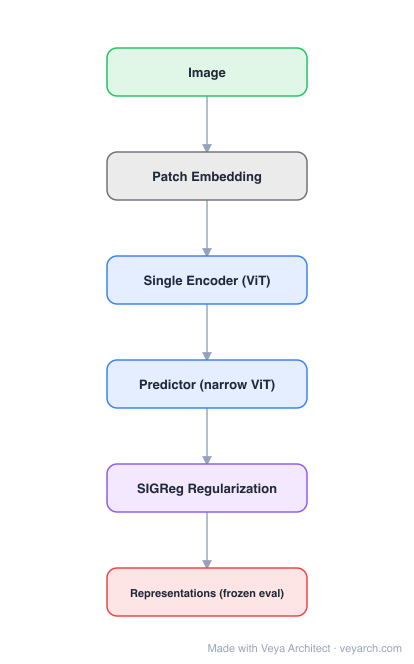

# Architecture: LeJEPA

## Motivation

Prior JEPA methods (I-JEPA, V-JEPA, V-JEPA 2) prevent representation collapse through **architectural asymmetry**: an EMA target encoder with stop-gradient, a separate predictor network, and carefully designed masking strategies. These heuristics work empirically but are poorly understood, require hyperparameter tuning, and add engineering complexity. VICReg improved on this with explicit variance-covariance regularization, but only constrains **second-order statistics**. LeJEPA asks: can we replace all heuristics with a single, provably optimal regularization term?

## Core Idea

**SIGReg (Sketched Isotropic Gaussian Regularization)**: force the embedding distribution to match an isotropic Gaussian. The theoretical foundation is that an isotropic Gaussian is the **optimal** embedding distribution for minimizing downstream prediction risk under the JEPA alignment objective. The implementation uses the Cramér-Wold theorem: instead of matching a high-dimensional distribution directly (intractable), project the embeddings onto a set of random directions and test whether each projection is univariate normal. This reduces distribution matching to O(d) complexity.

The architecture is radically simplified: a **single encoder** (no EMA, no stop-gradient) + a **small projector** + SIGReg loss. No predictor network is needed because the alignment objective between two views is sufficient when combined with the distribution constraint.

## Architecture

### Overview

<b>Layer-by-layer (6 nodes)</b>

| # | Layer | Type | Params |
|---|---|---|---|
| 1 | Image | `input` |  |
| 2 | Patch Embedding | `custom` |  |
| 3 | Single Encoder (ViT) | `attention` |  |
| 4 | Predictor (narrow ViT) | `attention` |  |
| 5 | SIGReg Regularization | `loss` |  |
| 6 | Representations (frozen eval) | `output` |  |

### Components

1. **Patch embedding** — standard ViT patch tokenization; both views share the same embedding.
2. **Single encoder (ViT)** — processes both views with **identical weights**; no EMA copy, no stop-gradient. Gradients flow freely through both branches.
3. **Predictor (narrow ViT)** — a lightweight transformer that predicts target-block representations from context-block representations. Unlike I-JEPA, the predictor is minimal because the alignment signal is simpler.
4. **Alignment loss** — MSE between predicted and encoded target representations, operating in latent space (not pixel space).
5. **SIGReg regularization** — the core innovation:
   - Project the batch of embeddings onto *K* random directions (sketches)
   - For each direction, test whether the projected values follow a univariate normal distribution (via a differentiable normality statistic)
   - Penalize deviation from normality
   - The Cramér-Wold theorem guarantees that if all 1D projections are normal, the full distribution is isotropic Gaussian
6. **Evaluation** — discard predictor and projector; freeze encoder; linear probing.

### Data Flow

Image → two masked views → single encoder (both views, shared weights) → predictor predicts target representations from context → alignment loss (MSE in latent space) + SIGReg (distribution matching via random projections). At eval: image → encoder → frozen features → linear probe.

### State / Memory

No persistent state. No EMA teacher, no memory bank, no momentum schedule. The method is fully stateless — SIGReg operates on the current batch only.

## Design Decisions

- **Full distribution matching over second-order statistics** — VICReg constrains variance (1st order) and covariance (2nd order); SIGReg constrains the *entire* distribution, which is provably stronger.
- **Isotropic Gaussian as the target distribution** — theoretically optimal for minimizing downstream prediction risk; the proof shows that non-Gaussian distributions introduce bias in linear probing.
- **Cramér-Wold sketching for tractability** — matching a d-dimensional distribution is O(d^2) or worse; sketching to K random directions reduces this to O(K·d), making it practical for high-dimensional embeddings.
- **No architectural asymmetry** — removing EMA, stop-gradient, and predictor complexity simplifies implementation to ~50 lines of regularization code.
- **Same configuration everywhere** — SIGReg needs no per-dataset or per-architecture tuning; the Gaussian target is universal.

## Evolution

- **VICReg** (2021): variance + covariance regularization — constrains second-order statistics only.
- **Barlow Twins** (2021): cross-correlation diagonalization — similar spirit, different mechanism.
- **I-JEPA / V-JEPA** (2023-2024): EMA target encoder + stop-gradient + predictor — architectural collapse prevention.
- **LeJEPA** (2025): replaces all heuristics with SIGReg — provably optimal distribution matching.
- **Successors**: **LeWM** (end-to-end world model with SIGReg), **LeVJEPA** (efficient video SSL with SIGReg), **LpWM** (extends SIGReg to sparse distributions via RDMReg), **AD-E2E-JEPA** (SIGReg projector for autonomous driving).

## Characteristics

| Property | Value |
|---|---|
| Task | self-supervised image representation |
| Encoder | ViT (single, symmetric, no EMA) |
| Collapse mechanism | SIGReg (full distribution matching to isotropic Gaussian) |
| Negatives | none |
| Stop-gradient | none |
| EMA teacher | none |
| Predictor | minimal narrow ViT |
| Loss | alignment (MSE in latent) + SIGReg (Cramér-Wold normality) |
| Scale | ImageNet-1K, ViT-H/14, 79% linear probing |

## Limitations

- The isotropic Gaussian target may be suboptimal for tasks requiring sparse or structured representations (addressed by LpWM's RDMReg).
- The Cramér-Wold sketching requires choosing the number of random directions K — though the method is robust to this choice.
- Theoretical optimality is proven under specific assumptions about the downstream task (linear probing); deeper downstream evaluation may benefit from non-Gaussian distributions.
- The alignment objective still requires a predictor, though it is much simpler than I-JEPA's.

## Implementation Notes

Essentials: (1) encode both views with a single shared-weight ViT (no EMA, no stop-gradient), (2) use a minimal predictor to align context and target representations in latent space, (3) apply SIGReg: project embeddings onto K random directions, test each for univariate normality, penalize deviation, (4) the total loss is alignment MSE + SIGReg penalty, (5) discard predictor and projector for evaluation. The SIGReg implementation is approximately 50 lines of code. No hyperparameter scheduling is needed — the same K and regularization weight work across datasets and architectures.
