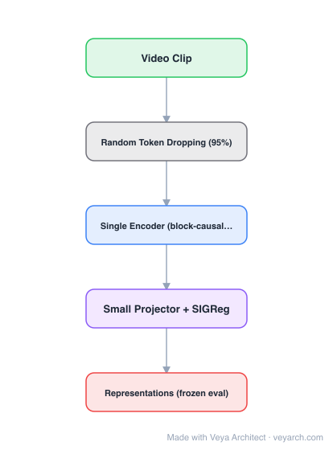

# Architecture: LeVJEPA

## Motivation

V-JEPA 2 and V-JEPA 2.1 achieve strong video representations but at high cost: an EMA target encoder (doubling encoder forward passes), a separate predictor network, structured spatio-temporal masking, and stop-gradient. These heuristics add compute, memory, and engineering complexity. LeJEPA already showed that SIGReg can replace all heuristics for image SSL. LeVJEPA asks: can the same simplification work for video, and can we make it even more efficient?

## Core Idea

Reduce video JEPA to its essence: **single encoder + small projector + SIGReg**. No EMA target encoder (saves ~50% encoder compute), no predictor network (saves a full transformer), no structured masking (replaced by random token dropping as augmentation), no stop-gradient. The encoder uses **block-causal attention** — each frame's representation is computed only from past and current frames — which naturally supports autoregressive world models and streaming inference without re-encoding. SIGReg prevents collapse throughout.

## Architecture

### Overview

<b>Layer-by-layer (5 nodes)</b>

| # | Layer | Type | Params |
|---|---|---|---|
| 1 | Video Clip | `input` |  |
| 2 | Random Token Dropping (95%) | `custom` |  |
| 3 | Single Encoder (block-causal ViT) | `attention` |  |
| 4 | Small Projector + SIGReg | `loss` |  |
| 5 | Representations (frozen eval) | `output` |  |

### Components

1. **Random token dropping** — instead of structured spatio-temporal tube masking, randomly drop up to 95% of tokens. This acts as **augmentation, not approximation** — the dropped tokens are simply not seen, and the encoder must produce good features from the remaining 5%. Surprisingly, this improves performance (33.9% → 47.6% at 95% drop rate).
2. **Single encoder (block-causal ViT)** — a ViT with block-causal attention: each frame attends only to itself and previous frames. This means:
   - Frame representations can be computed incrementally (streaming)
   - No re-encoding needed when new frames arrive (critical for autoregressive world models)
   - Time ordering becomes a property of the encoder itself, not just the data
3. **Small projector** — a lightweight MLP that maps encoder outputs to the space where SIGReg operates. Much smaller than V-JEPA 2's predictor.
4. **SIGReg** — the sole regularization: Cramér-Wold sketched isotropic Gaussian matching. Prevents collapse without any architectural asymmetry.
5. **Evaluation** — discard projector; freeze encoder; linear/attentive probing.

### Data Flow

Video clip → random token dropping (keep ~5%) → single block-causal ViT encoder → small projector → SIGReg (distribution matching) → frozen encoder features for evaluation.

### State / Memory

No persistent state. No EMA teacher, no memory bank. The block-causal attention means that during streaming inference, each frame's representation is cached and reused — no recomputation when new frames arrive.

## Design Decisions

- **Eliminate EMA target encoder** — V-JEPA 2's EMA doubles encoder compute; SIGReg makes it unnecessary, saving ~50% of encoder FLOPs.
- **Eliminate predictor** — V-JEPA 2's predictor is a full transformer; LeVJEPA replaces it with a tiny projector, since the alignment objective is simplified by SIGReg.
- **Random token dropping over structured masking** — structured masking (tubes, blocks) requires careful design; random dropping is simpler and acts as augmentation. The key finding: at 95% drop rate, performance *improves* because the model must learn robust features.
- **Block-causal attention** — enables streaming inference and autoregressive world models. Frame representations are computed once and reused. Performance matches full bidirectional attention in frozen probing.
- **SIGReg throughout** — the same mechanism that works for images (LeJEPA) works for video, with no modification.

## Evolution

- **V-JEPA** (2024): video JEPA with EMA + predictor + tube masking.
- **V-JEPA 2** (2025): scaled V-JEPA to 1M+ hours, added action-conditioned planning.
- **V-JEPA 2.1** (2026): added dense features via dense loss + deep supervision.
- **LeJEPA** (2025): introduced SIGReg for images, eliminating all heuristics.
- **LeVJEPA** (2026): applies SIGReg to video, eliminates EMA/predictor/masking, adds block-causal attention and random token dropping.
- **Contrast**: V-JEPA 2.1 takes the "add more training signal" approach; LeVJEPA takes the "remove complexity" approach. Both produce dense features.

## Characteristics

| Property | Value |
|---|---|
| Task | self-supervised video representation |
| Encoder | single block-causal ViT (no EMA) |
| Predictor | none (tiny projector only) |
| Masking | random token dropping (up to 95%) |
| Collapse mechanism | SIGReg (isotropic Gaussian) |
| Attention | block-causal (streaming-compatible) |
| Efficiency | 5.6–20.8× less compute than V-JEPA 2 |
| Scale | ViT-T to ViT-L; ViT-T in 12h on 1 GPU |

## Limitations

- Block-causal attention may lose information compared to bidirectional attention for tasks requiring future context (though frozen probing shows comparable performance).
- Random token dropping at very high rates (95%) may not work for all downstream tasks — tasks requiring fine spatial detail may suffer.
- No action-conditioned variant demonstrated (unlike V-JEPA 2-AC); extending to planning is future work.
- The tiny projector may limit the complexity of the alignment objective compared to a full predictor.

## Implementation Notes

Essentials: (1) tokenize video into tubelets, (2) randomly drop 80-95% of tokens (treat as augmentation), (3) encode remaining tokens with a single block-causal ViT (no EMA, no stop-gradient), (4) apply a small MLP projector, (5) loss = SIGReg on projected embeddings (no predictor, no alignment MSE between views — SIGReg alone), (6) for streaming: cache each frame's representation, only compute new frames. The block-causal attention is the key enabler for streaming and autoregressive use — implement it as a causal mask on the temporal dimension.
