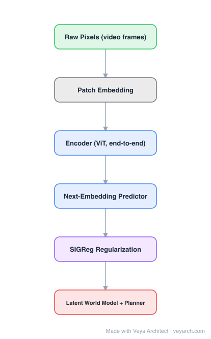

# Architecture: LeWM (LeWorldModel)

## Motivation

V-JEPA 2-AC demonstrated that a frozen video encoder + action-conditioned predictor can drive real robots. But the encoder was pretrained on 1M+ hours of video — a luxury not available for every domain. Prior attempts at end-to-end JEPA world models (training encoder + predictor jointly from pixels) required 6+ loss terms with careful balancing, and were unstable. LeWM asks: can SIGReg alone stabilize end-to-end JEPA training from pixels?

## Core Idea

A JEPA world model with **only two losses**: (1) next-embedding prediction loss (MSE between predicted and actual next-frame embeddings) and (2) SIGReg regularization (forcing embeddings to match an isotropic Gaussian). The encoder and action-conditioned predictor are trained **jointly from raw pixels** — no pretrained encoder, no EMA teacher, no stop-gradient. SIGReg prevents representation collapse throughout the entire pipeline, from pixel encoding to latent rollout to planning.

## Architecture

### Overview

<b>Layer-by-layer (6 nodes)</b>

| # | Layer | Type | Params |
|---|---|---|---|
| 1 | Raw Pixels (video frames) | `input` |  |
| 2 | Patch Embedding | `custom` |  |
| 3 | Encoder (ViT, end-to-end) | `attention` |  |
| 4 | Next-Embedding Predictor | `attention` |  |
| 5 | SIGReg Regularization | `loss` |  |
| 6 | Latent World Model + Planner | `output` |  |

### Components

1. **Patch embedding** — raw pixels are tokenized into patches; no pretrained tokenizer or frozen encoder.
2. **Encoder (ViT, end-to-end)** — a ViT trained from scratch on the task's pixel data. Gradients flow freely; no EMA copy, no stop-gradient. The encoder learns to produce embeddings that are both predictable (for the world model) and non-collapsed (via SIGReg).
3. **Next-embedding predictor** — an action-conditioned transformer that predicts the next frame's embedding given the current embedding and an action. This is the world model's dynamics component.
4. **Next-embedding MSE loss** — L2 regression between predicted and actual next-frame embeddings. This is the sole task loss.
5. **SIGReg regularization** — the sole regularization: Cramér-Wold sketched isotropic Gaussian matching on the encoder's output embeddings. This prevents collapse without any architectural asymmetry.
6. **Planning** — latent-space model-predictive control: roll out candidate action sequences in latent space, score outcomes, execute best first action.

### Data Flow

Raw pixels → patch embedding → encoder (ViT, end-to-end) → current latent → action-conditioned predictor → predicted next latent ↔ actual next latent (from encoder) → MSE loss + SIGReg on embeddings. For planning: pixels → encoder → latent → predictor (with candidate actions) → rollout → score → plan.

### State / Memory

No persistent state during training (no EMA, no memory bank). During planning rollouts, the latent state is carried forward across prediction steps. The predictor is autoregressive: each step's output feeds into the next step's input.

## Design Decisions

- **Two losses only** — prior end-to-end JEPA methods needed 6+ loss terms (reconstruction, KL, contrastive, EMA momentum, etc.); LeWM shows SIGReg + MSE is sufficient.
- **No pretrained encoder** — the entire pipeline trains from scratch on task-specific pixel data, making it applicable to domains without large-scale video pretraining.
- **SIGReg throughout** — the same regularization that prevents collapse in representation learning also stabilizes the world model's latent rollout.
- **Small scale (15M params)** — demonstrates that the approach works without massive compute; the stability comes from the loss design, not from scale.

## Evolution

- **V-JEPA 2-AC** (2025): frozen pretrained encoder + action-conditioned predictor — requires 1M+ hours of video pretraining.
- **LeJEPA** (2025): introduces SIGReg for representation learning — LeWM adopts it for world models.
- **LeWM** (2026): end-to-end from pixels with SIGReg — no pretraining needed.
- **Successors: LeHami** (2026): adds symplectic Hamiltonian dynamics for long-range rollout stability. **LpWM** (2026): extends to sparse representations via RDMReg.

## Characteristics

| Property | Value |
|---|---|
| Task | end-to-end latent world model from pixels |
| Encoder | ViT (trained from scratch, no pretraining) |
| Predictor | action-conditioned transformer |
| Losses | next-embedding MSE + SIGReg (2 total) |
| Collapse mechanism | SIGReg (isotropic Gaussian) |
| Scale | 15M params, single GPU, hours |
| Planning speed | 48× faster than baseline world models |
| Physical structure | spontaneously encoded in latent (verified by probing) |

## Limitations

- Validated on 2D and 3D control tasks (relatively simple environments) — not yet tested on real-robot multi-object interaction.
- 15M parameters is small; scaling behavior to larger models is untested.
- The latent space encodes physical structure implicitly — cannot directly decode explicit physical states (positions, contacts).
- No long-range rollout stability guarantee (addressed by LeHami).

## Implementation Notes

Essentials: (1) tokenize raw pixels into patches, (2) train a ViT encoder end-to-end (no freezing, no EMA), (3) train an action-conditioned predictor to predict next-frame embeddings, (4) loss = MSE(predicted, actual next embedding) + SIGReg(embeddings), (5) no other losses, no stop-gradient, no EMA, (6) plan by rolling out actions in latent space and scoring outcomes. The entire training loop is simpler than any prior end-to-end JEPA world model.
