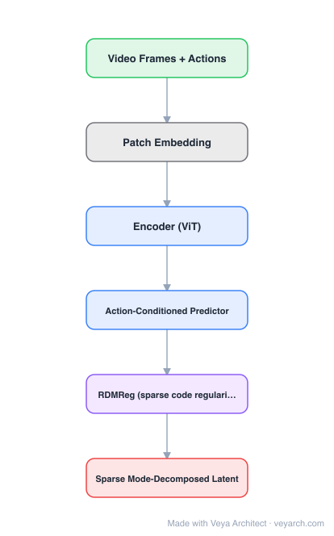

# Architecture: LpWM

## Motivation

JEPA world models (LeWM, V-JEPA 2-AC) use dense continuous representations. But many physical dynamics have **mixed discrete-continuous structure**: contact/no-contact is discrete, friction coefficient is continuous; on-ground/in-air is discrete, velocity is continuous. Dense representations must encode both in the same continuous space, which may be suboptimal. LpWM asks: is a **sparse** representation geometry better suited for dynamics modeling, and can it improve planning?

## Core Idea

Replace dense embeddings with **sparse non-negative codes** produced by RDMReg (Rectified Distribution Matching), which matches features to a rectified generalized Gaussian distribution. The theoretical foundation: for Lipschitz controlled dynamics, sufficiently high-dimensional one-hot representations allow action-conditioned **linear** dynamics to approximate the nonlinear dynamics, with rollout error vanishing as dimensionality grows. In practice, RDMReg produces codes that are not fully one-hot but are sparse — and these sparse codes are **mode-decomposable**: the active dimensions (support) indicate which dynamics regime the system is in, while the magnitudes encode the continuous state within that regime.

## Architecture

### Overview

<b>Layer-by-layer (6 nodes)</b>

| # | Layer | Type | Params |
|---|---|---|---|
| 1 | Video Frames + Actions | `input` |  |
| 2 | Patch Embedding | `custom` |  |
| 3 | Encoder (ViT) | `attention` |  |
| 4 | Action-Conditioned Predictor | `attention` |  |
| 5 | RDMReg (sparse code regularization) | `loss` |  |
| 6 | Sparse Mode-Decomposed Latent | `output` |  |

### Components

1. **Video frames + actions** — input is the current observation and the action to be taken.
2. **Patch embedding** — standard patch tokenization of the video frames.
3. **Encoder (ViT)** — produces latent representations. Unlike LeWM which produces dense Gaussian-distributed embeddings, the encoder here is trained to produce sparse codes via RDMReg.
4. **Action-conditioned predictor** — predicts the next frame's sparse latent given the current latent and an action. The predictor operates in sparse latent space.
5. **RDMReg regularization** — matches the encoder's output distribution to a rectified generalized Gaussian, producing **non-negative sparse codes**. This is the key difference from LeWM (which uses SIGReg → dense Gaussian). RDMReg generalizes SIGReg: the rectified generalized Gaussian has a sparsity parameter that controls how sparse the codes are.
6. **Sparse mode-decomposed latent** — the output latent is sparse: most dimensions are zero, a few are active. The active dimensions (support) encode the current dynamics regime; the magnitudes encode the continuous state within that regime.

### Data Flow

Video frames + actions → patch embedding → encoder (ViT) → sparse latent → action-conditioned predictor → predicted next sparse latent ↔ actual next sparse latent → MSE loss + RDMReg. For planning: roll out actions in sparse latent space, score outcomes.

### State / Memory

No persistent state during training (no EMA). During planning, the sparse latent state is carried forward. The sparsity means the state representation is more interpretable — you can inspect which dimensions are active to understand which dynamics regime the system is in.

## Design Decisions

- **RDMReg over SIGReg** — SIGReg produces dense Gaussian codes; RDMReg produces sparse non-negative codes. The sparsity is controlled by the generalized Gaussian's shape parameter.
- **Sparse latent for dynamics** — the theoretical motivation (Proposition 1) shows that sparse/one-hot representations enable linear dynamics approximation, which is easier to learn and rollout-stable.
- **Mode decomposition as emergent property** — the paper shows that sparse codes naturally decompose into modes without explicit mode supervision. The support pattern clusters by dynamics regime.
- **Same architecture as LeWM, different regularization** — the only architectural difference from LeWM is replacing SIGReg with RDMReg, making it easy to ablate.

## Evolution

- **LeWM** (2026): end-to-end JEPA world model with SIGReg (dense Gaussian).
- **LpWM** (2026): same architecture but with RDMReg (sparse codes) — shows sparsity improves planning.
- **Sibling: LeHami** (2026): structures dynamics via Hamiltonian (q,p) phase space — complementary approach (geometric structure vs. representational sparsity).
- **Theoretical roots**: sparse coding (Olshausen & Field), ICA, non-negative matrix factorization.

## Characteristics

| Property | Value |
|---|---|
| Task | action-conditioned world model with sparse latent |
| Encoder | ViT (same as LeWM) |
| Predictor | action-conditioned transformer (same as LeWM) |
| Regularization | RDMReg (rectified generalized Gaussian → sparse non-negative) |
| Latent geometry | sparse, mode-decomposable |
| Planning improvement | +57% over dense LeWM on PushT (medium-capacity predictor) |
| Mode structure | support = discrete regime, magnitude = continuous state |

## Limitations

- The +57% improvement is most pronounced with medium-capacity predictors; with very large predictors, dense representations may catch up.
- Sparse codes may lose fine-grained continuous information that dense codes preserve.
- The optimal sparsity level (RDMReg shape parameter) is task-dependent and requires tuning.
- Mode decomposition is emergent, not guaranteed — the paper shows it empirically but doesn't prove it always happens.
- Validated primarily on PushT and similar manipulation tasks; generalization to diverse environments is untested.

## Implementation Notes

Essentials: (1) use the LeWM architecture (encoder + action-conditioned predictor, end-to-end from pixels), (2) replace SIGReg with RDMReg: match the encoder output to a rectified generalized Gaussian distribution, (3) the rectified generalized Gaussian has a shape parameter controlling sparsity — tune it per task, (4) the loss is next-embedding MSE + RDMReg, (5) inspect the sparse codes' support patterns to verify mode decomposition, (6) for planning, roll out in sparse latent space as usual. The key insight: sparsity is not just regularization — it changes the representational geometry in a way that can better match mixed discrete-continuous physical dynamics.
