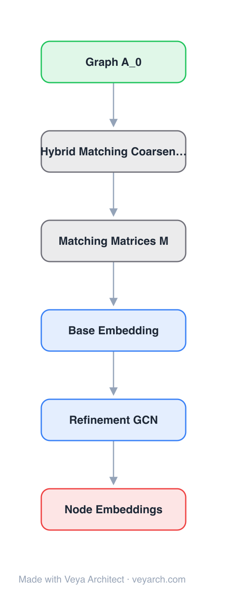

# Architecture: MILE Coarsening-Refinement Block

## Motivation

Graph embedding methods rarely scale to large datasets (e.g., graphs with more than 1 million nodes). Random-walk methods such as DeepWalk and Node2Vec need large amounts of CPU time to generate enough walks, while matrix-factorization methods such as GraRep and NetMF must construct enormous objective matrices — a 100K-node graph can require hundreds of GB of memory. Real-world graphs routinely reach billions of nodes (Google knowledge graph: 570M entities; Facebook: 1.39B users).

MILE makes the first attempt to close this gap generically. Rather than replacing the embedding method, it treats an existing method as a black box and scales it through a multi-level coarsen/refine process that also incorporates a holistic view of the graph.

## Core Idea

The block reduces a graph through repeated coarsening, computes embeddings on the coarsest graph with an off-the-shelf method, and refines the embeddings back to the original graph with a learned graph convolution network. The expensive embedding step runs only on the smallest graph, while the learned refinement lifts embeddings to every original node.

## Architecture

### Overview

<b>Layer-by-layer (6 nodes)</b>

| # | Layer | Type | Params |
|---|---|---|---|
| 1 | Graph A_0 | `input` |  |
| 2 | Hybrid Matching Coarsening | `custom` | strategies: SEM + NHEM |
| 3 | Matching Matrices M | `custom` |  |
| 4 | Base Embedding | `embed` | methods: DeepWalk / Node2Vec / GraRep / NetMF |
| 5 | Refinement GCN | `gcn-layer` |  |
| 6 | Node Embeddings | `output` |  |

The framework contains three key phases: (1) graph coarsening using a hybrid matching technique that maintains the backbone structure, (2) base embedding on the coarsest graph using any existing method, and (3) embedding refinement via a graph convolution network that learns to propagate embeddings from coarse to fine graphs. MILE is agnostic to the underlying embedding technique and applies to DeepWalk, Node2Vec, GraRep, NetMF and others without modification.

### Components

1. **Hybrid matching coarsening** — repeatedly coarsens the original graph using a hybrid strategy that combines Structural Equivalence Matching (SEM), which matches structurally equivalent nodes (nodes sharing the same neighbors), and Normalized Heavy Edge Matching (NHEM), which matches nodes connected by high-weight edges.
2. **Matching matrices** — each level stores `M_{i,i+1}`, which maps nodes from level `i` to level `i+1`; the coarsened adjacency is `A_{i+1} = M_{i,i+1}^T · A_i · M_{i,i+1}`. The matrices also drive the reverse refinement.
3. **Base embedding** — applies an existing graph embedding method (DeepWalk, Node2Vec, GraRep, NetMF) to the coarsest graph. This is inexpensive because the coarsest graph is far smaller than the original.
4. **Refinement GCN** — a learned graph convolution network that refines embeddings from the coarsest graph back to the original graph, leveraging the dependencies inherent in the graph structure and the base embedding method. It is trained on a learning task defined on the coarsest graph.

### Data Flow

1. **Input graph** `A_0` enters the block.
2. **Coarsening** produces a hierarchy of smaller graphs together with the matching matrices `M_{i,i+1}` that relate consecutive levels.
3. **Base embedding** runs the chosen method on the coarsest graph.
4. **Refinement** propagates and refines the coarse embeddings back through the hierarchy.
5. **Output** is the set of embeddings for the nodes of the original graph.

### State / Memory

Each coarsening level carries its matching matrix `M_{i,i+1}`; these matrices are the state that links the hierarchy and are reused during refinement.

## Design Decisions

1. **Black-box embedding** — the base embedding method is treated as a black box, so MILE delivers speed-ups without modifying or reimplementing the underlying algorithm.
2. **Hybrid matching** — combining SEM and NHEM preserves the graph backbone better than edge-only or structural-only matching, improving downstream embedding quality.
3. **Learned refinement over simple interpolation** — a graph convolution learns the coarse-to-fine mapping rather than using a fixed projection, which improves embedding quality while remaining cheap.

## Evolution

Predecessor: DeepWalk, Node2Vec, GraRep, NetMF (single-level embedding methods). Successor: multi-level graph pretraining and hierarchical graph-contrastive methods.

## References

- Liang et al. 2018 — MILE: A Multi-Level Framework for Scalable Graph Embedding (arXiv:1802.09612)
