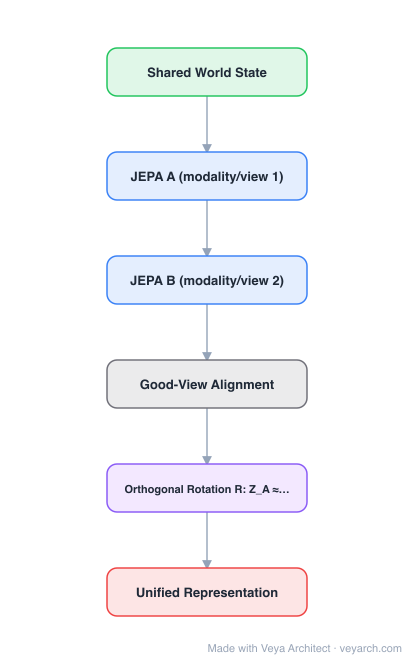

# Architecture: PRH-JEPA

## Motivation

The "Platonic Representation Hypothesis" — the empirical observation that different models trained on different data converge to similar representations — has been discussed informally but never proven. If true, it would mean that semantic latent representations (from video) and geometric state representations (from RGB-D) of the same scene are fundamentally the same, up to a rotation. This would provide a mathematical foundation for cross-modal alignment: instead of learning complex nonlinear mappings between representations, one only needs to find an orthogonal rotation. PRH-JEPA asks: can we prove this, and what are the conditions?

## Core Idea

A JEPA learns by predicting the representation of one observation from another. If the two observations are of the **same scene** ("good views" — e.g., two camera angles of the same room), then the JEPA's alignment objective forces the two representations to be similar. The theorem proves that under mild conditions (whitened second-order anti-collapse, spectral gap), the representations learned by any number of good-view JEPAs differ only by an **orthogonal rotation**. This means: (1) the representations are fundamentally the same (same information content), (2) the mapping between them is linear and distance-preserving (orthogonal), (3) the mapping can be learned from a small number of paired samples.

In contrast, next-token prediction (the LLM objective) is a "bad views" JEPA: the positive pairs (prefix and continuation of a document) are not two observations of the same scene — they are different parts of a temporal sequence. This explains why LLMs need massive scale to align with vision: they are solving a harder (bad-view) problem, not the easier (good-view) problem.

## Architecture

### Overview

<b>Layer-by-layer (6 nodes)</b>

| # | Layer | Type | Params |
|---|---|---|---|
| 1 | Shared World State | `input` |  |
| 2 | JEPA A (modality/view 1) | `attention` |  |
| 3 | JEPA B (modality/view 2) | `attention` |  |
| 4 | Good-View Alignment | `custom` |  |
| 5 | Orthogonal Rotation R: Z_A ≈ R·Z_B | `loss` |  |
| 6 | Unified Representation | `output` |  |

### Components

1. **Shared world state** — the underlying reality: a scene, a physical situation. Both JEPAs observe this same state through different modalities or viewpoints.
2. **JEPA A (modality/view 1)** — a JEPA trained on one modality or viewpoint (e.g., RGB video, camera A). Produces latent representation Z_A. Trained with SIGReg (isotropic Gaussian regularization) for anti-collapse.
3. **JEPA B (modality/view 2)** — a JEPA trained on a different modality or viewpoint (e.g., depth, camera B, or text description of the same scene). Produces latent representation Z_B. Also trained with SIGReg.
4. **Good-view alignment** — the key condition: the positive pairs for both JEPAs must be two observations of the **same scene**. Multi-camera observations of the same scene are naturally good views. The alignment step finds the mapping between Z_A and Z_B.
5. **Orthogonal rotation R** — the theorem proves that Z_A ≈ R · Z_B where R is an orthogonal matrix (R^T R = I). This means: (a) the mapping is linear, (b) it preserves distances (||R·z|| = ||z||), (c) it preserves angles. Only orthogonal rotations transfer — unconstrained linear maps or MLPs perform worse (COCO CIDEr: .806 orthogonal vs .635 linear vs .585 MLP).
6. **Unified representation** — the output: either Z_A or R·Z_B can serve as the unified representation. They contain the same information, just rotated. This is the mathematical formalization of "unified world representation."

### Data Flow

**Training**: Shared world state → JEPA A encodes view 1 → Z_A; JEPA B encodes view 2 → Z_B. Both trained independently with SIGReg. **Alignment**: collect paired (Z_A, Z_B) samples from the same scenes → solve for orthogonal R minimizing ||Z_A - R·Z_B|| → R is the alignment matrix. **Inference**: encode any view → rotate to the unified space via R.

### State / Memory

No recurrent state. The orthogonal rotation R is the persistent artifact — once learned, it maps between the two representation spaces. R is a matrix of size d×d where d is the latent dimension.

## Design Decisions

- **Good views as the key condition** — the theorem requires that positive pairs are two observations of the same scene. This is naturally satisfied by multi-camera setups but may not hold for arbitrary modality pairs (e.g., internet video and robot depth may not be good views of the same scenes).
- **Orthogonal rotation (not arbitrary mapping)** — the theorem proves the mapping is orthogonal. Empirically, only orthogonal rotations transfer: unconstrained linear maps or MLPs perform worse. This constrains the alignment to be distance-preserving.
- **SIGReg as anti-collapse** — the theorem assumes whitened second-order statistics, which SIGReg (isotropic Gaussian) satisfies. Without proper anti-collapse, the theorem doesn't hold.
- **Small-scale validation** — the experiments use 109M parameter models, not billion-scale. The scaling law (33 cells, RMSE .0067) suggests the results will hold at scale, but this is not proven.

## Evolution

- **LeJEPA** (2025): SIGReg and provable SSL — PRH-JEPA builds on SIGReg's theoretical foundation.
- **LeJEPA Identifiability** (2026): proves LeJEPA linearly recovers world state — PRH-JEPA proves different JEPAs converge to the same representation.
- **PRH-JEPA** (2026): proves the Platonic Representation Hypothesis for good-view JEPAs.
- **Theoretical roots**: Platonic Representation Hypothesis (Huh et al. 2024), conformal prediction, orthogonal Procrustes problem.

## Characteristics

| Property | Value |
|---|---|
| Task | cross-representation alignment (theoretical + practical) |
| Theorem | good-view JEPAs differ only by orthogonal rotation |
| Bad views | next-token prediction (explains LLM scale requirement) |
| Sample efficiency | 42× (21.6M vs 900M samples for equivalent alignment) |
| Scale | 109M params, 116B tokens; outperforms 660× larger models |
| Transfer | only orthogonal rotations (COCO CIDEr .806 vs .635 vs .585) |
| Zero-shot | ImageNet-100 top-5 64.4% (exceeds ≤56% benchmark bound) |
| Scaling law | 33 cells RMSE .0067, unseen cells RMSE .0115 |

## Limitations

- **Idealized assumptions** — the theorem assumes whitened second-order anti-collapse and spectral gap conditions. Real models may not exactly satisfy these.
- **42× is sample ratio, not compute prophecy** — the 42× advantage is in sample count, not total compute. Cannot be extrapolated to "JEPAs are 42× cheaper than LLMs."
- **Metric geometry doesn't transfer** — absolute quantities (depth in meters, rotation angles) do not transfer across representations. Only ordinal relationships transfer.
- **Limited experimental scale** — 109M parameter text JEPA vs 72B language model. The scale gap is large but the text JEPA's training data (116B tokens) is still substantial.
- **Good views may not hold for all modality pairs** — multi-camera observations are naturally good views, but semantic latents (from internet video) and geometric states (from RGB-D) may not be good views of the same scenes.
- **Orthogonal rotation is restrictive** — if the two representations have different dimensionalities or information content, an orthogonal rotation cannot align them. The theorem assumes equal-dimensional representations.

## Implementation Notes

Essentials: (1) train two (or more) JEPAs on different modalities/views of the same scenes, each with SIGReg, (2) collect paired latent samples (Z_A, Z_B) from the same scenes, (3) solve the orthogonal Procrustes problem: find R minimizing ||Z_A - R·Z_B|| subject to R^T R = I (via SVD: R = U V^T where Z_A^T Z_B = U Σ V^T), (4) at inference: encode any view, rotate to unified space via R, (5) verify alignment quality by checking that distance relationships are preserved (ordinal, not metric), (6) for unpaired alignment: use the zero-shot procedure (no paired samples needed, but lower performance). The key insight: cross-modal alignment is mathematically guaranteed to be an orthogonal rotation, not a complex nonlinear mapping — but only if the modalities are "good views" of the same underlying reality.
