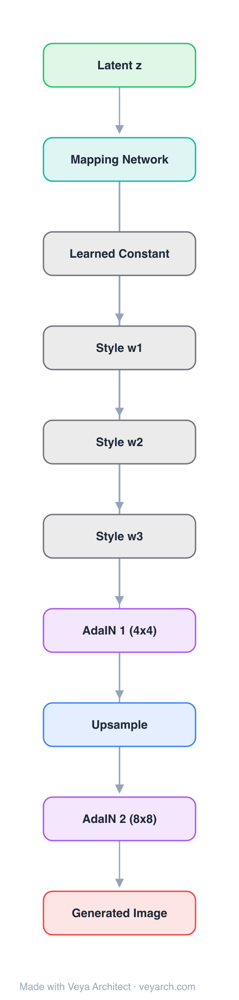

# Architecture: StyleGAN

## Motivation

Traditional GAN generators map noise directly to images with limited control. StyleGAN introduces style-based generation where a learned constant is modulated at each layer, enabling fine-grained control over image features at different scales.

## Core Idea

Replace the input noise with a learned constant. Inject noise via AdaIN (Adaptive Instance Normalization) at each resolution level. Use noise injection for stochastic detail and mapping network for style control.

## Architecture

### Overview

<b>Layer-by-layer (10 nodes)</b>

| # | Layer | Type | Params |
|---|---|---|---|
| 1 | Latent z | `input` | shape: [512] |
| 2 | Mapping Network | `linear` | outFeatures: 512, inFeatures: 512 (8-layer MLP) |
| 3 | Learned Constant | `identity` | 4x4x512 learned feature |
| 4 | Style w1 | `custom` | per-layer style vector (4x4) |
| 5 | Style w2 | `custom` | per-layer style vector (8x8) |
| 6 | Style w3 | `custom` | per-layer style vector (reserved) |
| 7 | AdaIN 1 (4x4) | `batchNorm` | style modulation via AdaIN |
| 8 | Upsample | `convTranspose` | 4x4 -> 8x8 |
| 9 | AdaIN 2 (8x8) | `batchNorm` | style modulation |
| 10 | Generated Image | `output` | toRGB via 1x1 conv |

### Components

1. **Mapping network** — An 8-layer MLP that maps z to w (style vector), disentangling the latent space. 2. **Learned constant** — A fixed 4x4x512 tensor replaces the traditional noise input. 3. **AdaIN** — Adaptive Instance Normalization: normalize activations, then modulate with style w (scale and bias from w). 4. **Noise injection** — Per-pixel Gaussian noise added after each convolution, providing stochastic detail. 5. **Progressive growing** — Layers are added progressively during training (4x4 to 1024x1024).

### Data Flow

1. **Input** — The input is fed into the first layer.
2. **Forward pass** — Each layer processes its input and passes the result to the next layer.
3. **Output** — The final layer produces the model's prediction.

### State / Memory

See component descriptions above for state/memory details.

## Design Decisions

1. **Architecture choice** — Replace the input noise with a learned constant. Inject noise via AdaIN (Adaptive Instance Normalization) at each resolution level. Use noise injection for stochastic detail and mapping network for st
2. **Key tradeoff** — Balance between expressiveness and computational efficiency.

## Evolution

Predecessor: Progressive GAN. Successor: StyleGAN2, StyleGAN3, StyleGAN-T.

## References

- Karras et al. 2019
