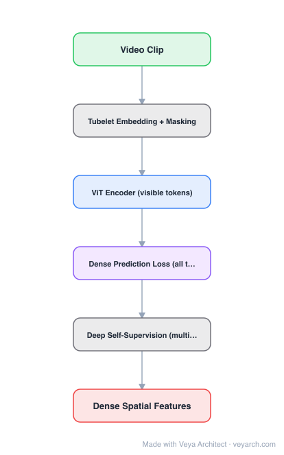

# Architecture: V-JEPA 2.1

## Motivation

V-JEPA 2 demonstrated that masked latent prediction at scale produces excellent video representations for understanding and planning. However, its patch-level features are **spatially unstructured** — the PCA of patch tokens does not separate objects from background, limiting performance on dense prediction tasks (depth, segmentation, tracking) and fine-grained manipulation. V-JEPA 2.1 asks: can we unlock dense spatial features without sacrificing the global representation quality that makes V-JEPA 2 effective?

## Core Idea

Extend V-JEPA 2's training with four additions that together produce **spatially-structured dense features**: (1) a **dense prediction loss** that supervises all tokens (visible and masked), not just masked ones; (2) **deep self-supervision** that applies the JEPA objective at multiple encoder depths; (3) a **multimodal tokenizer** that unifies image and video under one scheme; (4) **effective scaling** of both model and data. The key insight is that dense features are not a byproduct of scaling — they require an explicit training signal that forces every spatial location to carry meaningful information.

## Architecture

### Overview

<b>Layer-by-layer (6 nodes)</b>

| # | Layer | Type | Params |
|---|---|---|---|
| 1 | Video Clip | `input` |  |
| 2 | Tubelet Embedding + Masking | `custom` |  |
| 3 | ViT Encoder (visible tokens) | `attention` |  |
| 4 | Dense Prediction Loss (all tokens) | `loss` |  |
| 5 | Deep Self-Supervision (multi-layer) | `custom` |  |
| 6 | Dense Spatial Features | `output` |  |

### Components

1. **Tubelet embedding + masking** — spatio-temporal patch tokenization with masking, as in V-JEPA 2. The multimodal tokenizer extension allows the same scheme to handle both images (single-frame video) and video.
2. **ViT encoder (visible tokens)** — processes visible tokens only, as in V-JEPA 2. The encoder is deeper and wider, with intermediate-layer features being explicitly supervised.
3. **Dense prediction loss** — the key innovation: the loss is computed over **all token positions** (visible and masked), not just masked ones. This forces the encoder to produce meaningful features at every spatial location, not just where prediction is required.
4. **Deep self-supervision** — the JEPA prediction objective (predict target representations from context) is applied at multiple intermediate layers of the encoder, not just the final layer. This produces a hierarchy of features from low-level spatial to high-level semantic.
5. **EMA target encoder** — retained from V-JEPA 2 for producing stable prediction targets, with stop-gradient.
6. **Output: dense spatial features** — patch-token features that exhibit clear object-background separation in PCA, suitable for depth estimation, tracking, and manipulation.

### Data Flow

Video clip → multimodal tokenization → mask tubelets → ViT encoder (visible tokens) → dense prediction loss over all positions + deep self-supervision at intermediate layers → EMA target encoder provides targets → dense spatial features for downstream tasks.

### State / Memory

The EMA target encoder is retained from V-JEPA 2 as persistent slowly-updated memory. Deep self-supervision adds intermediate-layer state but no additional persistent memory.

## Design Decisions

- **Dense loss over all tokens** — V-JEPA 2 only supervises masked positions; V-JEPA 2.1 supervises all positions, which is what creates spatial structure. The visible tokens must also carry predictive signal.
- **Multi-layer supervision** — applying the JEPA objective at multiple depths produces features at different abstraction levels, useful for different downstream tasks.
- **Multimodal tokenization** — unifying image and video under one tokenizer enables joint pretraining, leveraging both data sources without modality-specific pipelines.
- **Retain EMA target encoder** — V-JEPA 2.1 keeps the EMA + stop-gradient mechanism rather than switching to SIGReg, preserving compatibility with V-JEPA 2 checkpoints and the V-JEPA 2-AC planning pipeline.

## Evolution

- **V-JEPA** (2024): video latent prediction with EMA targets and tube masking.
- **V-JEPA 2** (2025): scaled to 1M+ hours, action-conditioned planning, but lacks dense features.
- **V-JEPA 2.1** (2026): adds dense loss, deep supervision, multimodal tokenizer — unlocks spatial structure.
- **Sibling: LeVJEPA** (2026): takes the opposite approach — simplifies the architecture with SIGReg and no EMA/predictor, but also achieves dense features via block-causal attention.
- **Contrast: VideoMAE** — pixel reconstruction produces dense features but at the cost of modeling photometric detail.

## Characteristics

| Property | Value |
|---|---|
| Task | self-supervised video representation (dense + global) |
| Tokenizer | spatio-temporal tubelets, multimodal (image+video) |
| Encoder | ViT on visible tokens, multi-layer supervision |
| Targets | EMA target encoder, stop-gradient |
| Loss | dense prediction (all tokens) + deep self-supervision (multi-layer) |
| Dense features | yes — PCA shows object-background separation |
| Scale | SOTA on Ego4D, EPIC-KITCHENS, NYUv2, SSv2 |

## Limitations

- Retains the EMA + stop-gradient machinery, unlike the simpler LeVJEPA approach.
- Dense loss increases compute per step compared to masked-only loss.
- The multimodal tokenizer adds complexity to the data pipeline.
- Deep self-supervision requires storing intermediate features, increasing memory.

## Implementation Notes

Essentials: (1) use the V-JEPA 2 architecture as the base, (2) extend the loss to cover all token positions (visible and masked), (3) add JEPA prediction heads at 2-4 intermediate encoder layers, (4) implement the multimodal tokenizer to handle both images and video with the same patch scheme, (5) scale model and data together. The dense loss is the single most important addition — without it, patch tokens remain spatially unstructured regardless of scale.
