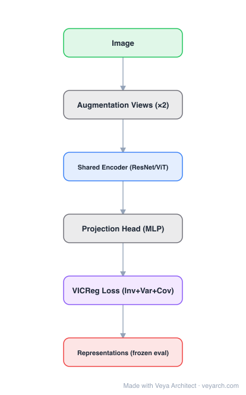

# Architecture: VICReg

## Motivation

Self-supervised representation learning faced two failure modes. Contrastive methods (SimCLR, MoCo) need large batches of negatives and careful augmentation. Non-contrastive methods (BYOL, SimSiam) avoid collapse only through architectural tricks — stop-gradient, EMA momentum encoders, predictor asymmetry — whose mechanism was poorly understood. VICReg's thesis: **collapse can be prevented by explicitly regularizing the embedding distribution** with variance and covariance terms, removing the need for negatives or asymmetric architectures.

## Core Idea

Encode two augmented views of each image with a **symmetric twin-encoder** (shared weights, no stop-gradient, no EMA). Apply three losses on the resulting batch of embeddings:

1. **Invariance** (reconstruction-style): MSE between the two views' embeddings for each image.
2. **Variance**: a hinge loss per dimension forcing the batch standard deviation above a threshold γ — every dimension must stay "alive."
3. **Covariance**: the off-diagonal of the batch covariance matrix is driven to zero — dimensions must be decorrelated, preventing redundancy and rank collapse.

The covariance term is the key novelty: it operates on the full batch covariance (not just per-pair), and it explicitly targets the *shape* of the embedding distribution, not just pairwise distances.

## Architecture

### Overview

<b>Layer-by-layer (7 nodes)</b>

| # | Layer | Type | Params |
|---|---|---|---|
| 1 | Image | `input` |  |
| 2 | Augmentation View 1 | `custom` |  |
| 3 | Augmentation View 2 | `custom` |  |
| 4 | Shared Encoder (ResNet/ViT) | `conv` |  |
| 5 | Projection Head (MLP) | `custom` |  |
| 6 | VICReg Loss (Invariance + Variance + Covariance) | `loss` |  |
| 7 | Representations (frozen evaluation) | `output` |  |

### Components

1. **Augmentation pipeline** — standard SSL augmentations (crop, color jitter, blur); two views per image.
2. **Shared encoder** — a ResNet or ViT applied to both views with **identical weights** (no EMA, no stop-gradient).
3. **Projection head** — a 2-3 layer MLP that maps encoder features to the embedding space where regularization is applied; discarded at evaluation.
4. **Invariance loss** — `‖z₁ − z₂‖²` averaged over the batch.
5. **Variance loss** — for each dimension *j*: `max(0, γ − √(Var(z_j) + ε))`; γ is typically 1.0.
6. **Covariance loss** — for the batch covariance matrix *C* (normalized): `Σ_{i≠j} C_{ij}² / d`; drives off-diagonal to zero.
7. **Evaluation** — discard projection head; freeze encoder; train a linear probe or k-NN on downstream tasks.

### Data Flow

Image → two augmented views → shared encoder (both views) → projection head → embeddings z₁, z₂ → VICReg loss (invariance on pairs + variance per dimension + covariance on batch). At eval: image → encoder → frozen features → linear probe.

### State / Memory

No persistent state. No EMA teacher, no memory bank. The method is stateless beyond the current batch — the covariance and variance are computed over the batch.

## Design Decisions

- **Explicit distribution constraints over architectural asymmetry** — the central design choice; replaces stop-gradient/EMA with direct regularization of the embedding geometry.
- **Variance hinge** — prevents the trivial collapse where all dimensions become constant; the hinge allows dimensions to exceed γ freely.
- **Covariance on the full batch** — not pairwise; captures the global shape of the distribution and prevents rank-1 collapse.
- **Symmetric encoder** — both views use the same weights with gradients flowing freely; simplifies implementation and analysis.
- **Projection head discarded** — the regularization operates in a space separate from the downstream representation, similar to SimCLR.

## Evolution

- **Barlow Twins** (2021): also uses a covariance-like term (cross-correlation matrix diagonalization) — VICReg generalizes this with explicit variance maintenance.
- **SimCLR / MoCo** (contrastive predecessors): need negatives; VICReg does not.
- **BYOL / SimSiam** (non-contrastive predecessors): need stop-gradient/EMA; VICReg does not.
- **VICReg** (2021): explicit variance + covariance regularization, symmetric encoder.
- **Successor: SIGReg / LeJEPA** (2025): replaces second-order statistics (variance + covariance) with **full distribution matching** to an isotropic Gaussian — provably optimal, ~50 lines of code, no EMA/stop-gradient/predictor.

## Characteristics

| Property | Value |
|---|---|
| Task | self-supervised image representation |
| Encoder | ResNet-50 or ViT (symmetric, shared weights) |
| Collapse mechanism | explicit variance + covariance regularization |
| Negatives | none |
| Stop-gradient | none |
| EMA teacher | none |
| Loss | invariance (MSE) + variance (hinge) + covariance (off-diagonal penalty) |
| Scale | ImageNet-1K; competitive with SimCLR/BYOL |

## Limitations

- Only constrains **second-order statistics** (variance and covariance); higher-order distribution structure is uncontrolled — collapse to non-Gaussian distributions is not prevented.
- The variance threshold γ and covariance weight are hyperparameters that need tuning.
- Covariance term is O(d²) in embedding dimension, which can be costly for very large embeddings.
- Superseded by SIGReg (LeJEPA), which constrains the *entire* distribution and is provably optimal.

## Implementation Notes

Essentials: (1) apply standard augmentations to produce two views, (2) encode both with a shared-weight encoder (no EMA, no stop-gradient), (3) project to an embedding space with an MLP head, (4) compute three losses — MSE between paired embeddings, per-dimension variance hinge, and off-diagonal covariance penalty, (5) discard the projection head for evaluation. The variance threshold γ ≈ 1.0 and covariance weight ≈ 0.04 are reasonable defaults. Do not add negatives or an EMA branch — the regularization terms are the collapse-prevention mechanism.
